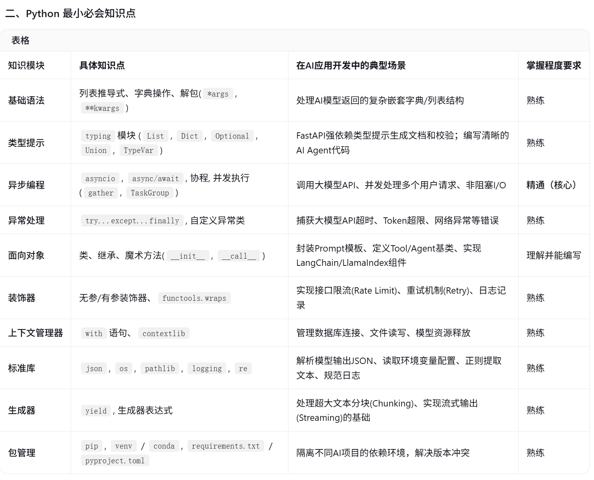

```
作为AI应用开发工程师 Python和FastAPI需要掌握到什么程度，哪些是必须要掌握的最小详细知识点，知识点讲解，标出与AI应用开发工程师相关的学习重点

Python
- 基础语法
- 数据结构
- 函数
- 面向对象编程
- 模块与包
- 标准库
- 装饰器
- 迭代器、生成器
- 上下文管理器
- 异常处理
- 文件操作
- 异步编程async 、 await、asynio
- 类型提示
- 数据校验 Pydantic 

HTTP、web、FastAPI
- HTTP基础
- RESTful API
- Json
- FastAPI
- MiddleWare
- SSE
- Websocket
- 异步请求

## 格式要求
- 输出Markdown
- 用表格呈现知识点
```

一、总体掌握程度要求
作为AI应用开发工程师（而非底层算法工程师或纯后端工程师），你的核心目标是将AI模型能力包装成可靠的服务并构建应用。因此：

Python：不需要精通所有底层机制，但必须熟练掌握异步编程、数据处理、类型提示和工程化规范，因为你需要频繁对接各种AI SDK、处理JSON/流式数据以及编写胶水代码。
FastAPI：不需要深入底层源码，但必须熟练掌握路由、依赖注入、Pydantic数据校验、SSE流式响应和中间件，这是目前构建LLM应用（如RAG、Agent服务）最主流的框架




