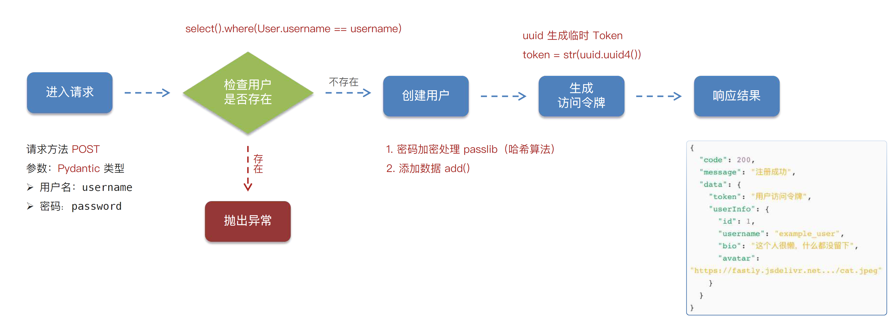
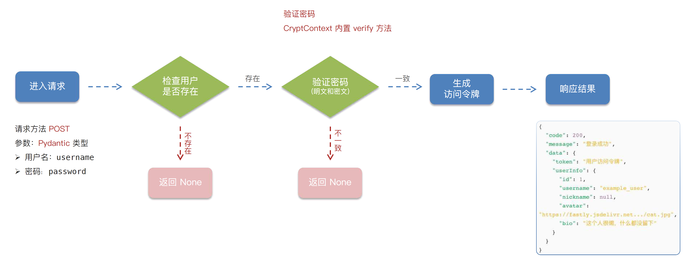
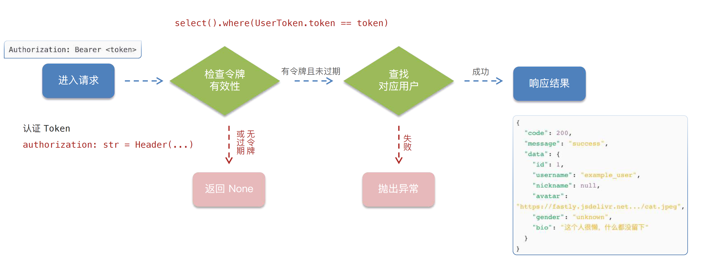
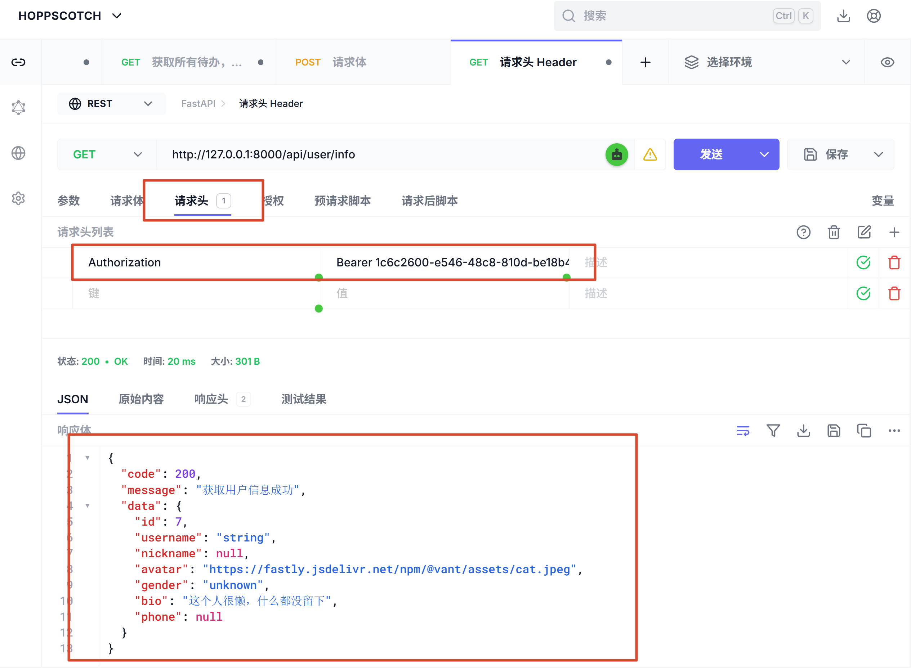

## 模块化路由
模块化路由就是把每个业务功能的接口`拆分`到独立文件里，再统一`挂载`到主应用中
- **项目结构更清晰**：接口按模块拆分，不会混在一起，让整个项目结构更直观
- **更易维护**：每个模块都负责自己对应的接口，便于快速查找和定向修改
- **避免 main.py 爆炸**：把接口拆分出去后，main.py 就只负责启动应用，不用堆满业务代码

### 模块化路由实现
#### 1. 模块化目录结构
```
app/
|————routers/
     |————users.py
     |————news.py
```

#### 2. 编写独立路由模块
/routers/users.py
```python
from fastapi import APIRouter

router = APIRouter(prefix="api/user", tags=["user"]) # tags 是接口文档分组

@router.get("/info")
async  def get_user_info():
    return {"msg": "获取用户信息成功"}
```

#### 3. 在 main.py 中挂载路由
/main.py
```python
app.include_router(users.router)
```


## 接口实现流程
### 1. 模块化路由
- 定义`APIRouter`实例
- 注册路由`include_router`
- 参照`接口规范文档`

### 2. 定义模型类
- 参数`数据库表`

### 3. 数据库CRUD
- select(模型类)
- add()
- update()
- delete()

### 4. 路由调用逻辑
- `Depends`注入数据库依赖
- 调用逻辑
- 响应结果


## 用户管理模块
### 1. 用户注册
- 接口地址：`POST /api/user/register`
- 请求参数：（Pydantic UserRequest -> 请求体）

| 参数名 | 类型 | 必填 | 说明 |
|--------|------|------|------|
| username | string | 是 | 用户名 |
| password | string | 是 | 密码 |



> **用户注册逻辑**：通过 username 验证用户是否存在 -> 创建用户 -> 生成 Token -> 响应结果（token+user_info）

#### passlib 密码加密
安装
```bash
uv add passlib[bcrypt] passlib[argon2] 
```

```python
from passlib.context import CryptContext
# 创建加密上下问
pwd_context = CryptContext(schemes=["argon2", "bcrypt"], deprecated="auto")
# 加密
def get_password_hash(password: str) -> str:
    return pwd_context.hash(password)
# 密码校验
def verify_password(plain_password: str, hashed_password: str) -> bool:
    return pwd_context.verify(plain_password, hashed_password)
```

#### Token
Token：是服务器发给客户端的一段字符串，用来在后续请求中证明"你已经登录过了"
作用：解决 HTTP 是无状态的问题，在每次请求中"自我证明身份"

登录或注册 -> 后端生成 Token -> 后端返回 Token -> 前端保存 Token -> 每次请求携带 Token -> 后端验证 Token

Token在请求中的位置：`请求头`
`Authorization: Bearer <token>`
- `Authorization`: 专门用来放身份信息
- `Bearer`：表示"持有者令牌"
- `<token>`: 真正的身份凭证(后端生成)


```python
# 生成 Token
async def create_token(db: AsyncSession, user_id: int):
    # 生成 Token + 设置过期时间 -> 查询 user_token 数据库是否已存在该用户 -> 有：更新; 没有：存入 user_token 数据库
    token = str(uuid.uuid4())
    expires_at = datetime.now() + timedelta(days=7)

    query = select(UserToken).where(UserToken.user_id == user_id)
    result = await db.execute(query)
    user_token = result.scalar_one_or_none()

    if user_token:
        user_token.token = token
        user_token.expires_at = expires_at
    else:
        user_token = UserToken(user_id=user_id, token=token, expires_at=expires_at)
        db.add(user_token)
        await db.commit()
    return token
```

### 2. 用户登录
- 接口地址：`POST /api/user/login`
- 请求参数：（Pydantic UserRequest -> 请求体）

| 参数名 | 类型 | 必填 | 说明 |
|--------|------|------|------|
| username | string | 是 | 用户名 |
| password | string | 是 | 密码 |



> **用户登录逻辑**：通过 username 验证用户是否存在并验证密码 -> 生成 Token -> 响应结果（token+user_info）

### 3. 用户信息获取
- 接口地址：`GET /api/user/info`
- 请求头：需要认证



> 用户已经登录的情况下，前端在发送请求的时候会在请求头中携带 Token，后端通过 Token 获取用户信息 <br>
> 函数：`获取 Token + 根据 Token 查询用户 (查询 Token -> 检查 Token 是否过期 -> 查询对应用户)` 后续用户信息更新，用户密码修改，都需要用这个函数，所以抽取出一个公共函数 auth.py

/utils/auth.py
```python
async def get_current_user(
        authorization: str = Header(..., alias="Authorization"),
        db: AsyncSession = Depends(get_db)
):
    # Bearer xxxxx 
    # 1. 获取 token
    token = authorization.replace("Bearer ", "") # token = authorization.split(" ")[1]
    # 2. 根据 token 获取用户
    user = await users_crud.get_user_by_token(db, token)
    if not user:
        raise HTTPException(status_code=status.HTTP_401_UNAUTHORIZED, detail="无效的令牌或已经过期的令牌")
    return user
```



### 4. 用户信息更新
- 接口地址：`PUT /api/user/info`
- 请求头：需要认证
- 请求参数：（Pydantic UserInfoResponse -> 请求体）

| 参数名 | 类型 | 必填 | 说明 |
|--------|------|------|------|
| nickname | string | 否 | 昵称 |
| avatar | string | 否 | 头像URL |
| gender | string | 否 | 性别 |
| bio | string | 否 | 个人简介 |
| phone | string | 否 | 手机号 |

### 5. 用户密码修改
- 接口地址：`PUT /api/user/password`
- 请求头：需要认证
- 请求参数：（Pydantic UserInfoResponse -> 请求体）

| 参数名 | 类型 | 必填 | 说明 |
|--------|------|------|------|
| oldPassword | string | 是 | 当前密码 |
| newPassword | string | 是 | 新密码 |

## 跨域资源共享 CORS
- 跨域资源共享（CORS）是一种浏览器基于`同源`策略的安全机制，默认会阻止网页向不同源的服务器发起请求
- 同源的三个条件：`协议`、`域名`、`端口`

```
from fastapi.middleware.cors import CORSMiddleware
app = FastAPI()
origins = [
    "http://localhost",
    "http://localhost:3000",
    "https://your-fronted-domain.com"
]
app.add_middleware(
    CORSMiddleware,
    allow_origins=["*"],      # 允许访问的源
    allow_credentials=True,   # 允许携带 Cookie
    allow_methods=["*"],      # 允许所有 HTTP 请求方法
    allow_headers=["*"],      # 允许所有请求头
)
```